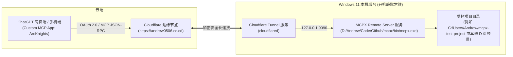

# MCPX 本机部署与 ChatGPT 远程协作全流程指南

本文档记录了在 Windows 11 环境下完整搭建 **MCPX (Remote MCP Server)**、配置 **Cloudflare 永久加密隧道**、固化为 **Windows 开机自启系统服务** 以及接入 **ChatGPT 网页端** 的完整配置与日常使用方法。

---

## 1. 核心架构与运行原理



---

## 2. 关键连接参数与凭据

| 配置项 | 参数值 | 说明 |
| :--- | :--- | :--- |
| **项目工作目录** | `D:\Andrew\Code\Github\mcpx` | 源码、可执行二进制与管理脚本 |
| **永久公网 MCP 端点** | `https://andrew0506.cc.cd/mcp` | 填入 ChatGPT 的 MCP Server URL |
| **认证方式** | `OAuth` | 仅授权用户可调用 |
| **OAuth 授权口令** | `e1866b306dec02b074b26a9ce6a934882bf4b782cd20d9042733ec0e9f77e746` | 首次在 ChatGPT 绑定时输入 |
| **全局配置文件** | `D:\Andrew\Code\MCPX\config.yaml` | 存放全局安全策略、命令白名单、端口 |
| **应用图标包** | `D:\Andrew\Code\Github\mcpx\assets\app_icon.png` | 8.17 KB 原版 ALAS 图标（<10KB） |

---

## 3. Windows 开机自启与服务管理

本项目已封装为 Windows 系统服务，待机资源占用极低（**内存合计 ≈ 45MB，CPU 0%**），无需打开任何终端窗口。

### 常用管理操作：

* **一键安装 / 启动所有自启服务**：
  双击运行 `D:\Andrew\Code\Github\mcpx\install.bat`（自动获取管理员权限，注册 Cloudflare 与 MCPX 服务）。
* **一键停止 / 卸载所有服务**：
  双击运行 `D:\Andrew\Code\Github\mcpx\uninstall.bat`。
* **手动查看服务状态**：
  按 `Win + R` 输入 `services.msc`，查看 `Cloudflare Tunnel` 和 `MCPX Remote Server` 的运行状态。

---

## 4. 如何挂载新的本地项目（Workspace 注册）

AI 无法随意遍历你的全盘，只能访问你明确登记过的工作区。如果你想让 ChatGPT 操作 D 盘的其他项目：

```powershell
cd D:\Andrew\Code\Github\mcpx
.\bin\mcpx.exe workspace register "D:\Andrew\Code\你的新项目路径"
```

登记后，无需重启服务，ChatGPT 在下次对话中即可自动通过 `workspace` 工具列出并切换到该项目！

---

## 5. ChatGPT 网页端标准使用流程

在新对话中挂载 **ArcKnights** 应用后，ChatGPT 的标准调用链路：

1. **发现工作区**：调用 `workspace(action="list")`，获取已登记的项目名称。
2. **开启会话**：调用 `session(action="open", workspace="项目名")`，获得隔离的 `remote_session_id`。
3. **安全读取**：调用 `read(path="...")` 读取源码文件并获取 `base_sha256`。
4. **精确修改**：调用 `edit(path="...", ...)` 提交带校验的代码变更（防脏写机制）。
5. **执行测试**：调用 `execute(command="python test.py")` 在受控环境下运行测试命令并反馈输出。

---

## 6. 常见排错与日志

* **公网健康检查**：
  浏览器访问 `https://andrew0506.cc.cd/.well-known/oauth-protected-resource`，若返回 JSON 元数据即代表全链路正常。
* **MCPX 审计日志**：
  所有 AI 的读写和执行操作均记录在 `D:\Andrew\Code\MCPX\logs\audit.jsonl` 中。
* **服务运行日志**：
  服务运行日志保存在 `D:\Andrew\Code\MCPX\logs\mcpx.log`。
